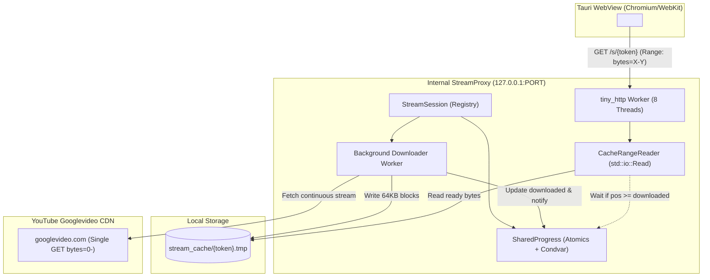

# Nada Continuous Stream-Caching Proxy & 1:04 Playback Fix

*   **Author:** anlian
*   **Status:** In Review
*   **Date:** 2026-11-23

--------------------------------------------------------------------------------

## Overview

Nada is a lightweight, ad-free desktop music and video player built with Tauri and Rust. It streams media from YouTube Music through a local proxy server. Currently, playback consistently terminates at approximately the 1:04 mark due to upstream CDN enforcement of Proof-of-Origin (PO) tokens on segmented range requests.

This design document specifies a zero-external-binary continuous stream-caching proxy architecture in Rust. When media playback starts, the internal proxy initiates a single unsegmented upstream request starting at byte 0, streams incoming bytes directly to an ephemeral local cache file, and serves arbitrary byte-range requests (including backward and forward seeks) directly to the WebView from disk.

## The Problem

1. **Premature Playback Failure at 1:04**:
   `src-tauri/src/proxy.rs` splits upstream media fetches into 1 MiB (`1024 * 1024` bytes) slices using HTTP `Range` headers. For audio bitrates between 128 kbps and 160 kbps, 1 MiB represents roughly 64 seconds of playback.
2. **Upstream Bot Mitigation & 403 Forbidden**:
   While YouTube's `googlevideo.com` CDN permits initial range requests starting from byte 0 (`bytes=0-1048575`), it enforces Proof-of-Origin (PO) / Botguard token checks on non-zero range requests (`bytes=1048576-2097151`), responding with `HTTP 403 Forbidden`.
3. **Bloat vs. Reliability Trade-Off**:
   Standard workarounds rely on external companion binaries like `rustypipe-botguard` (which bundles a 30–40 MB Deno/V8 JavaScript runtime to solve Botguard VM challenges). This conflicts with Nada's goal of remaining a lightweight desktop application with zero external binary dependencies.
4. **The Unsegmented Stream Bypass**:
   Empirical testing demonstrates that issuing an unsegmented range request from byte 0 (`Range: bytes=0-` or full GET) allows the client to stream the entire audio or video file without encountering 403 errors. The existing proxy fails because it artificially slices the stream into multiple discrete upstream HTTP connections.

## Goals

*   **Uninterrupted Playback**: Provide continuous audio and video playback beyond 1:04 for the entire duration of any track.
*   **Zero External Binaries**: Implement the solution entirely within Nada's Rust backend using existing dependencies (`tiny_http`, `reqwest`, `tokio`), avoiding sidecars or external JS engines.
*   **Responsive Seeking**: Enable low-latency (<10 ms) backward scrubbing and forward seeking within already-downloaded byte ranges, and handle forward seeking beyond current download progress without crashing or socket disconnects.
*   **Cross-Platform Portability**: Deliver a solution that runs on Windows first and works identically on Linux and macOS using standard Rust filesystem and threading primitives.
*   **Storage & Bandwidth Hygiene**: Store cached media only in ephemeral temporary files, automatically terminate obsolete upstream network downloads upon track changes, and purge orphaned files at application launch.

## Non-Goals

*   **Permanent Offline Library**: The cache is purely ephemeral for playback buffer management; it does not replace local music file management or persistent offline downloads.
*   **Transcoding or Remuxing**: The proxy operates strictly at the byte/transport layer without decoding, encoding, or multiplexing audio/video containers.
*   **Custom Botguard JS Emulation**: No attempt to reverse-engineer or emulate Google Botguard VM execution in Rust or JavaScript.

## Critical User Journeys (CUJs)

### CUJ 1: Uninterrupted Full-Track Playback
*   **Given**: Nada is running on Windows, and the user selects a 4-minute song from Home or Search.
*   **When**: The user clicks play and listens continuously without interacting with controls.
*   **Then**: The track plays past the 1:04 mark smoothly to the end of the song without buffering pauses, socket terminations, or 403 errors. Upon track completion, the next song begins playing automatically.

### CUJ 2: Scrubbing and Seeking
*   **Given**: A song has been playing for 30 seconds, and the local stream cache has downloaded 2.5 MB of audio data.
*   **When**: The user drags the progress bar backward to 0:10, or forward to 1:30 (within the downloaded 2.5 MB window).
*   **Then**: The audio resumes immediately without network roundtrips, served directly from the local file cache.

### CUJ 3: Rapid Track Skipping
*   **Given**: The user is browsing a playlist and skips through 5 consecutive tracks within 3 seconds.
*   **When**: The user clicks the "Next" button repeatedly.
*   **Then**: Background streaming tasks for earlier tracks are cancelled immediately via atomic flags, releasing network sockets upon connection close without orphan thread accumulation.

--------------------------------------------------------------------------------

## Technical Plan (Architecture)

### Architectural Overview

The core architectural change replaces the slicing chunk reader (`ChunkReader`) with a decoupled **Single-Writer, Multi-Reader Ephemeral File-Backed Cache**.



### Core Data Structures & State Machine

#### 1. `SharedProgress`
Coordinates the single background writer thread with one or more reader threads serving HTTP range requests:

```rust
pub struct SharedProgress {
    pub downloaded: AtomicU64,
    pub total: Mutex<Option<u64>>,
    pub mime: Mutex<String>,
    pub is_complete: AtomicBool,
    pub is_cancelled: AtomicBool,
    pub error: Mutex<Option<String>>,
    pub notify: Condvar,
    pub lock: Mutex<()>,
}
```

*   `downloaded`: Total byte count flushed to the temp file. Readers inspect this using `Ordering::Acquire`.
*   `total`: The upstream stream's total byte length (extracted from `Content-Length` or `Content-Range`).
*   `notify` & `lock`: A condition variable pair. When a reader encounters `pos >= downloaded`, it sleeps on `notify.wait_timeout()` rather than returning `Ok(0)`.
*   `is_complete`: Set by the background downloader when the upstream stream reaches EOF.
*   `is_cancelled`: Set when the session is evicted or replaced, signalling the background thread to break its read loop immediately.

#### 2. `StreamSession`
Represents an active or recent media stream:

```rust
pub struct StreamSession {
    pub token: String,
    pub url: String,
    pub file_path: PathBuf,
    pub progress: Arc<SharedProgress>,
    pub started: AtomicBool,
}
```

#### 3. `StreamProxy`
Manages active sessions and enforce an LRU retention limit:

```rust
pub struct StreamProxy {
    port: u16,
    sessions: Arc<Mutex<HashMap<String, Arc<StreamSession>>>>,
    lru_order: Arc<Mutex<std::collections::VecDeque<String>>>,
    hasher: std::collections::hash_map::RandomState,
    cache_dir: PathBuf,
    log: Arc<Mutex<std::fs::File>>,
}
```

#### 4. `CacheRangeReader`
Implements `std::io::Read` to serve data to `tiny_http::Response`:

```rust
pub struct CacheRangeReader {
    file: std::fs::File,
    pos: u64,
    end: u64,
    progress: Arc<SharedProgress>,
}
```

*   **File Cursor Positioning**: Upon every `read()` call, the reader executes `self.file.seek(SeekFrom::Start(self.pos))?` before reading from disk to ensure non-zero range requests (`start > 0`) read the exact requested segment.
*   **Wait Invariant (No False EOF)**: When `self.pos >= downloaded`, the reader loops and waits on `progress.notify` with a 200 ms timeout.
*   **Termination Conditions**:
    *   If `self.pos > self.end` or (`is_complete && self.pos == total`), returns `Ok(0)` (legitimate EOF for the requested range).
    *   If `is_cancelled` is true, returns `std::io::ErrorKind::Interrupted`.
    *   If an upstream error occurred, returns `std::io::Error`.

### Concurrency & Lifecycle Flow

1.  **Stream Registration (`StreamProxy::register`)**:
    *   Generates a token from URL hash.
    *   If a session already exists for the token in `sessions`, it refreshes its position in `lru_order` and immediately returns the stream URL.
    *   Creates a unique temp file path: `cache_dir.join(format!("{token}.tmp"))`.
    *   Instantiates `StreamSession` with `started: AtomicBool::new(false)`, inserts it into `sessions`, and records it in `lru_order`.
    *   Enforces max 10 active tracks in `lru_order`; evicted sessions are marked cancelled (`is_cancelled = true`) and their temp files unlinked safely (`let _ = std::fs::remove_file(...)`).
    *   **Lazy Execution**: Does NOT spawn network threads eagerly in `register()`. This avoids triggering 6–12 simultaneous downloads during batch format queries in `streams()` and allows dual-stream (video + audio) playback without interference.
2.  **HTTP Request Handling & Lazy Worker Initiation (`serve`)**:
    *   `tiny_http` receives `GET /s/{token}` with an optional `Range: bytes=start-end`.
    *   Extracts the corresponding `StreamSession`.
    *   **Lazy Downloader Launch**: Performs `session.started.compare_exchange(false, true, Ordering::SeqCst, Ordering::SeqCst)`. If it succeeds, launches the background `download_worker` thread. Subsequent range requests or chunk reads on the same session skip launching.
    *   **Metadata Resolution Contract**: Waits on `SharedProgress::notify` with a 3.0-second timeout until `total.is_some() || is_complete || error.is_some()`. If the timeout expires or an error is recorded, responds immediately with `HTTP 502 Bad Gateway`.
    *   Calculates effective range `start..=end`.
    *   Opens an independent read handle to the cache file with shared read permissions.
    *   Constructs `CacheRangeReader` and responds with `HTTP 206 Partial Content`:
        *   `Content-Range: bytes {start}-{end}/{total}`
        *   `Content-Type: {mime}`
        *   `Accept-Ranges: bytes`
3.  **Downloader Worker (`download_worker`)**:
    *   Opens the temp file with non-exclusive shared read/write permissions.
    *   Sends a single unsegmented request: `reqwest::blocking::Client::get(&url).header("Range", "bytes=0-")`.
    *   Inspects `Content-Length` and `Content-Type` headers to populate `progress.total` and `progress.mime`, immediately pulsing `progress.notify.notify_all()`.
    *   Streams incoming bytes in 64 KiB chunks, appending to disk via `BufWriter`.
    *   After each chunk flush, increments `progress.downloaded` with `Ordering::Release` and calls `progress.notify.notify_all()`.
    *   Upon reaching upstream EOF, marks `is_complete = true` and flushes buffers.
4.  **Session Cleanup & Garbage Collection**:
    *   At app startup: `src-tauri/src/lib.rs` executes `let _ = std::fs::remove_dir_all(&cache_dir);` and re-creates an empty directory.
    *   When an older session is evicted: `is_cancelled` is set to `true`, and temp file deletion is executed best-effort (`let _ = std::fs::remove_file(...)`), ignoring Windows sharing violations if reader handles are still flushing.

--------------------------------------------------------------------------------

## Alternatives Considered

### Alternative A: Bundling `rustypipe-botguard` as a Tauri Sidecar
*   **Description**: Distribute the precompiled `rustypipe-botguard` binary alongside the Tauri application and invoke it via CLI to solve YouTube Botguard VM challenges.
*   **Pros**: Generates authentic Proof-of-Origin (PO) tokens, enabling arbitrary sliced range requests on web client streams.
*   **Cons**: Adds 30–40 MiB of binary overhead (bundled Deno/V8 engine + JSDOM); adds child process lifecycle management and multi-platform packaging complexity.
*   **Reason for Rejection**: Violates the project requirement of maintaining a zero-external-binary, lightweight installer footprint (<15 MB).

### Alternative B: In-Memory RAM Ring Buffer (`VecDeque<u8>`)
*   **Description**: Store incoming unsegmented stream bytes in an in-memory memory buffer rather than persisting to temporary disk files.
*   **Pros**: Avoids disk I/O, leaves zero filesystem traces, and avoids filesystem permissions or sharing violation issues.
*   **Cons**: Memory consumption escalates during video playback (a single 720p/1080p music video reaches 50–300 MB). Multiple queued tracks or split video/audio streams risk Out-Of-Memory (OOM) process crashes on low-spec systems.
*   **Reason for Rejection**: Unacceptable memory footprint risk. Disk-backed caching safely delegates page management to the OS virtual memory subsystem, providing near-RAM access speeds via OS page caching without heap bloat.

### Alternative C: Switching to Android or TV Innertube Client
*   **Description**: Configure `rustypipe` to request streams using `ClientType::Android` or `ClientType::Tv`, which historically bypassed strict PO token enforcement.
*   **Pros**: Avoids local caching if YouTube allows range requests on those clients.
*   **Cons**: High fragility. YouTube regularly modifies signature deciphering algorithms (`signatureCipher` / `n` parameter) on Android/TV clients. Live testing demonstrated that `rustypipe` currently fails with `could not get deobf data` on Android and `could not extract sig fn name` on TV. In contrast, the iOS client provides direct, unencrypted stream URLs.
*   **Reason for Rejection**: High maintenance liability and immediate breakage due to rolling signature cipher updates. The iOS client with byte-0 caching is deterministic and reliable during empirical testing.

--------------------------------------------------------------------------------

## Non-Functional Requirements

### Performance & Latency
*   **Time-To-First-Byte (TTFB)**: Must remain under 150 ms for initial track playback. Writing to disk must be performed asynchronously without blocking the initial HTTP response header transmission to the WebView.
*   **Seek Latency**: Backward seeks and forward seeks within the downloaded buffer must resolve in <10 ms directly from the local file handle.
*   **CPU Utilization**: The background stream writer must sleep when no data is available and consume <2% CPU during active streaming.

### Storage & Security
*   **Data Isolation**: Cache files are restricted to Nada's sandboxed `app_local_data_dir/stream_cache/` directory.
*   **Disk Footprint Ceiling**: For typical audio tracks (Opus/AAC at 128–160 kbps), each file is ~5–8 MB, keeping the 10-session LRU cache within ~50–80 MB total. For higher-bitrate or video tracks (150–250 MB per stream), the LRU size can be tuned dynamically or cleared if disk constraints require.
*   **Ephemeral Persistence & Lock Safety**: Cache files are named with SHA-derived tokens without exposing video IDs or user metadata on disk. Deletions during eviction use best-effort unlinking (`let _ = std::fs::remove_file(...)`) to avoid Windows sharing conflicts, and all temporary cache files are cleanly purged on application startup (`remove_dir_all(&cache_dir)`).
*   **Localhost Binding**: The internal proxy binds strictly to loopback (`127.0.0.1:0`), preventing external network access to the media proxy.

--------------------------------------------------------------------------------

## Detailed Implementation Plan

### Target Files to Create/Modify

#### 1. `src-tauri/src/proxy.rs` (Modify)
*   **Type / Scope**: Rust Network Proxy Module.
*   **Rationale**: Replace the fragile 1 MiB chunked range fetcher with the decoupled single-writer, multi-reader disk-backed streaming proxy.
*   **Proposed Structural Changes**:
    *   **Cleanup**: Delete obsolete `ChunkReader`, `fetch_chunk`, and existing chunk slice unit tests.
    *   **Data Types**:
        *   Define `SharedProgress`: Encapsulates `downloaded: AtomicU64`, `total: Mutex<Option<u64>>`, `mime: Mutex<String>`, `is_complete: AtomicBool`, `is_cancelled: AtomicBool`, `error: Mutex<Option<String>>`, `notify: Condvar`, `lock: Mutex<()>`.
        *   Define `StreamSession`: Holds `token: String`, `url: String`, `file_path: PathBuf`, `progress: Arc<SharedProgress>`, and `started: AtomicBool`.
        *   Define `CacheRangeReader`: Holds cloned read-only `std::fs::File`, `pos: u64`, `end: u64`, and `progress: Arc<SharedProgress>`. Implements `std::io::Read` with `notify.wait_timeout()` loop semantics to prevent premature EOF.
    *   **Functions & Methods**:
        *   `StreamProxy::start(log_path: PathBuf, cache_dir: PathBuf) -> Result<Self, String>`: Initialize server, thread pool, sessions map, LRU queue, and store `cache_dir`.
        *   `StreamProxy::register(&self, url: &str, total: Option<u64>) -> String`: Hash URL, instantiate `StreamSession` if not already present, insert into `sessions`, push token to `lru_order`, evict oldest if `lru_order.len() > 10` by setting `is_cancelled = true` and unlinking file, and return `http://127.0.0.1:{port}/s/{token}`. Does NOT spawn worker eagerly.
        *   `download_worker(session: Arc<StreamSession>, client: reqwest::blocking::Client, log: Arc<Mutex<File>>)`: Background thread issuing `GET` with `Range: bytes=0-`, reading into a 64 KiB buffer, writing to disk, updating `progress.downloaded`, and pulsing `notify.notify_all()`.
        *   `serve(...)`: Update request handler to look up session. If `session.started.compare_exchange(false, true, Ordering::SeqCst, Ordering::SeqCst).is_ok()`, spawn `download_worker`. Wait on `notify` for metadata readiness, construct `CacheRangeReader`, and return `HTTP 206 Partial Content`.
    *   **Unit Tests**:
        *   Mock server testing continuous sequential download past 1 MB.
        *   Mock range request at non-zero offset (`bytes=1048576-2097151`) served from cache.
        *   Reader pause-and-resume verification with simulated slow network writer.
        *   Cancellation verification when `is_cancelled` is set.

#### 2. `src-tauri/src/lib.rs` (Modify)
*   **Type / Scope**: Tauri Core Application Initialization.
*   **Rationale**: Configure stream cache storage path and clean up orphaned temporary files on launch.
*   **Proposed Structural Changes**:
    *   In `setup` closure:
        *   Derive `let cache_dir = storage_dir.join("stream_cache");` before `storage_dir` is consumed by value in `RustyPipe::builder().storage_dir(storage_dir)`.
        *   Sweep existing files on startup: `let _ = std::fs::remove_dir_all(&cache_dir);` followed by `let _ = std::fs::create_dir_all(&cache_dir);`.
        *   Pass `cache_dir` into `proxy::StreamProxy::start(proxy_log, cache_dir)`.

#### 3. `src/app.js` (Verify / Maintain)
*   **Type / Scope**: Frontend Web Application Controller.
*   **Rationale**: Ensure audio/video elements interact seamlessly with the 206 Partial Content range responses and seeking behavior.
*   **Proposed Verification**:
    *   Verify that `onTimeUpdate` and `progress.addEventListener("change", ...)` seek correctly into the stream proxy.
    *   Verify error handling in `onError` does not trigger falsely during buffer catch-up.

### Verification Plan

*   **Compilation & Linting**:
    *   `cargo check --manifest-path "src-tauri/Cargo.toml"`: Must compile cleanly with 0 warnings.
    *   `cargo clippy --manifest-path "src-tauri/Cargo.toml"`: Clean pass.
*   **Unit Tests**:
    *   `cargo test --manifest-path "src-tauri/Cargo.toml"`: All proxy unit tests pass (including mock range and reader tests).
*   **Real Media Playback Verification (Smoke Test)**:
    *   Run integration test against live YouTube Music audio track:
        *   Play track continuously past 1:04 (e.g. up to 1:30+). Confirm 0 HTTP 403 errors in `proxy.log`.
        *   Seek backward (e.g. from 1:20 to 0:15). Verify immediate playback resumption.
        *   Seek forward past current buffer. Verify clean waiting without playback abort.
        *   Test rapid track skipping: advance through 3 tracks within 5 seconds and verify previous tracks are cancelled without socket leakage.
        *   Test split video/audio playback: verify both streams buffer and play concurrently.
